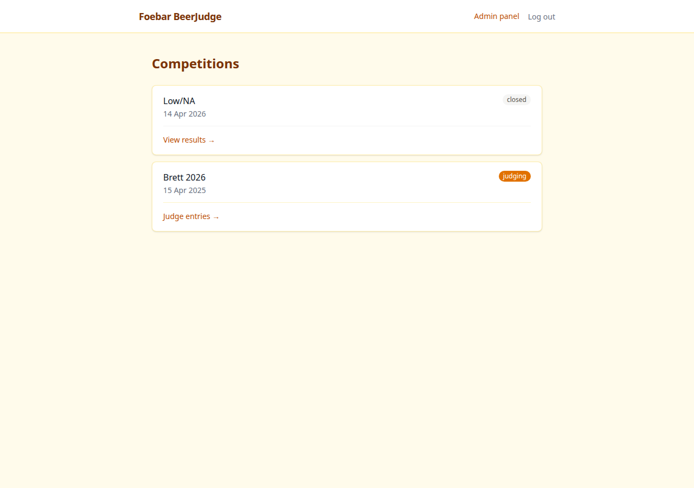

# BeerJudge

Competition management for a small homebrew club. Members register beers, judges score them on the BJCP 50-point scale, and each competition produces a ranked result list.

Deliberately narrow in scope: no payments, no shipping, no BJCP report generation, no multi-club support. Built for roughly ten people running four competitions a year.

## Screenshots

| Home | Judging screen | Scoresheet |
|---|---|---|
|  |  |  |

| Admin — competition entries | Results |
|---|---|
|  |  |

## Stack

- Laravel 13 + Filament 4 (admin panel)
- Blade + Alpine.js (judging screen)
- IndexedDB for offline scoresheet backup on the judging screen
- Postgres + Redis (production); SQLite + database drivers (simple local)
- Session-based auth; sessions last about a week

No Livewire on the judging screen. Livewire re-renders from the server on every interaction, which drops in-progress input on a network blip. Alpine handles local state; IndexedDB backs it up.

## Getting started

### Simple local setup (SQLite, no external services)

No Postgres or Redis needed. Uses SQLite and database-backed sessions/cache/queue. Good for quick feature work and frontend changes.

```bash
cp .env.example .env
php artisan key:generate
composer install
php artisan migrate --seed     # seeds the BJCP 2021 and Brewers Association 2026 style sets
npm install
composer run dev:lite          # artisan serve + queue:listen + pail + vite, SQLite mode
```

`dev:lite` overrides the database/session/cache drivers at runtime, so your `.env` stays unchanged. The SQLite file is created automatically.

An existing database that predates the Brewers Association styles gets them with `php artisan db:seed --class=BaStyleSeeder --force` (safe to repeat; it upserts by code and source).

### Local dev with Postgres + Redis (production parity)

Starts only the backing services so Vite HMR and fast PHP iteration still work natively. Use this when testing queue behaviour, session handling, or anything that needs to match production closely.

```bash
cp .env.docker.example .env
# edit .env: set APP_KEY (php artisan key:generate) and adjust credentials if needed
composer install
npm install
docker compose up postgres redis   # starts postgres:16 and redis:7, exposed on localhost
php artisan migrate --seed
composer run dev                   # artisan serve + queue:listen + pail + vite
```

### Full Docker stack

Builds and runs the entire app in a container (nginx + php-fpm + queue worker via supervisord):

```bash
cp .env.docker.example .env
# edit .env: set APP_KEY, CLUB_NAME, APP_URL, and any credentials you want to change
docker compose up --build
# app at http://localhost:8080
```

On first run the container runs `php artisan migrate --force` automatically.

### Running tests

```bash
php artisan test
./vendor/bin/phpstan analyse
```

## Architecture

Two frontends, one app.

**Filament** handles all management: members, competitions, styles, entries, bottle-number assignment, results, and judge variance flags.

**Judging screen** is a single Blade route. The entry list is server-rendered on load; no entries API. Alpine writes each scoresheet to IndexedDB as the judge fills it, then POSTs to the server. On failure it queues and retries. The server upserts by `client_uuid`, so retries are idempotent. A submitted sheet can be reopened and resaved until the competition closes.

## Competition lifecycle

`draft` → `open` → `judging` → `closed`

During `open`, members register entries. When moved to `judging`, registration locks, bottle numbers are assigned, and scoring begins. Judges can score any entry except their own. Once `closed`, everything locks.

Final score is the average of submitted totals. Tiebreak is the averaged overall-impression score (BJCP convention). Rankings are competition-wide, not per style.

## Results

Admins see results at any status; members see them once the competition is `closed`. There is no separate publish step. Closing queues an email to every active member with an entry, linking to their sheet. One URL per participant: their scores and judge notes, then the full standings with brewer names revealed. Each sheet is printed from its own page, reached through the results index.

## Documentation

**Judging**
- [Reference](docs/judging/reference.md) — routes, payload shape, validation rules, sync states
- [How to judge a competition](docs/judging/howto-judge.md)
- [Why the judging screen is offline-first](docs/judging/explanation-offline-sync.md)
- [DescriptorService reference](docs/judging/descriptor-service-reference.md) — off-flavour descriptor list and validation
- [Why descriptors are stored as JSON](docs/judging/descriptor-service-explanation.md)

**Competition**
- [Lifecycle reference](docs/competition/lifecycle-reference.md) — status transitions, schema, Filament actions
- [How to run a competition](docs/competition/lifecycle-howto.md)
- [Why the lifecycle has four states](docs/competition/lifecycle-explanation.md)
- [Results reference](docs/competition/results-reference.md) — routes, access rules, view data
- [How to view results](docs/competition/results-howto.md)
- [Ranking service reference](docs/competition/ranking-service-reference.md)
- [Bottle assignment reference](docs/competition/bottle-assignment-reference.md)

**Members**
- [Registration reference](docs/member/registration-reference.md) — invitation model, routes, validation
- [How to register a new member](docs/member/registration-howto.md)
- [Auth reference](docs/member/auth-reference.md) — password, magic link, password reset routes
- [How to log in](docs/member/auth-howto.md)

**Admin**
- [Artisan commands reference](docs/admin/artisan-commands-reference.md) — member:create, member:delete, member:password
- [How to create a member via CLI](docs/admin/artisan-commands-howto.md)
- [BJCP seeder reference](docs/admin/bjcp-seeder-reference.md)
- [How to seed BJCP styles](docs/admin/bjcp-seeder-howto.md)
- [Why Filament](docs/admin/filament-overview-explanation.md)

**Architecture**
- [Two-frontend architecture](docs/architecture/two-frontend-explanation.md) — Filament vs Blade+Alpine split
- [BJCP scoring model](docs/architecture/bjcp-scoring-explanation.md) — sections, bands, ranking, tiebreak

**Operations**
- [Environment variables](docs/env-reference.md)
- [Docker reference](docs/docker-reference.md)
- [How to deploy with Docker](docs/docker-howto.md)
- [PWA reference](docs/pwa-reference.md)

## Self-hosting

The app ships as a Docker image (nginx + php-fpm + queue worker in one container). Postgres and Redis run as separate containers via Docker Compose.

The image is built on a development machine and pushed to the private package `ghcr.io/oekeur/beerjudge:latest`. The server holds no checkout: only `docker-compose.yaml`, `docker-compose.prod.yaml` and `.env.production`, and it pulls the image. CI does not build or push images. Full steps, verification and rollback are in [How to deploy with Docker](docs/docker-howto.md).

### Prerequisites

- Docker + Docker Compose on the server and the development machine
- An [nginx-proxy](https://github.com/nginx-proxy/nginx-proxy) setup on the server handling TLS termination, on an external Docker network named `proxy`
- `docker login ghcr.io` on both machines

### Deploy

1. On the development machine, from a clean checkout of `main`:

   ```bash
   docker compose build app
   docker push ghcr.io/oekeur/beerjudge:latest
   ```

2. First time only: copy `docker-compose.yaml` and `docker-compose.prod.yaml` to the server and create `.env.production` from `.env.docker.example`. Set at minimum:
   - `APP_KEY`: generate with `php artisan key:generate --show`
   - `APP_ENV=production`, `APP_DEBUG=false`
   - `APP_URL=https://yourdomain.com`
   - `CLUB_NAME`, `DB_PASSWORD`, `MAIL_*`
   - `VIRTUAL_HOST` (and `LETSENCRYPT_HOST` if acme-companion issues the certificate); nginx-proxy reads them from the app container's environment

   Compose passes `${DB_PASSWORD}` to Postgres from the shell or a `.env` file next to the Compose files, not from `.env.production`, so put the same value in `.env` too.

3. On the server:

   ```bash
   docker compose -f docker-compose.yaml -f docker-compose.prod.yaml pull app
   docker compose -f docker-compose.yaml -f docker-compose.prod.yaml up -d
   ```

Watchtower on the server cannot pull the private image, so it does not deploy BeerJudge.

The container runs `php artisan migrate --force` on every start, so deploys are zero-touch. Data persists in named Docker volumes (`postgres_data`, `redis_data`).