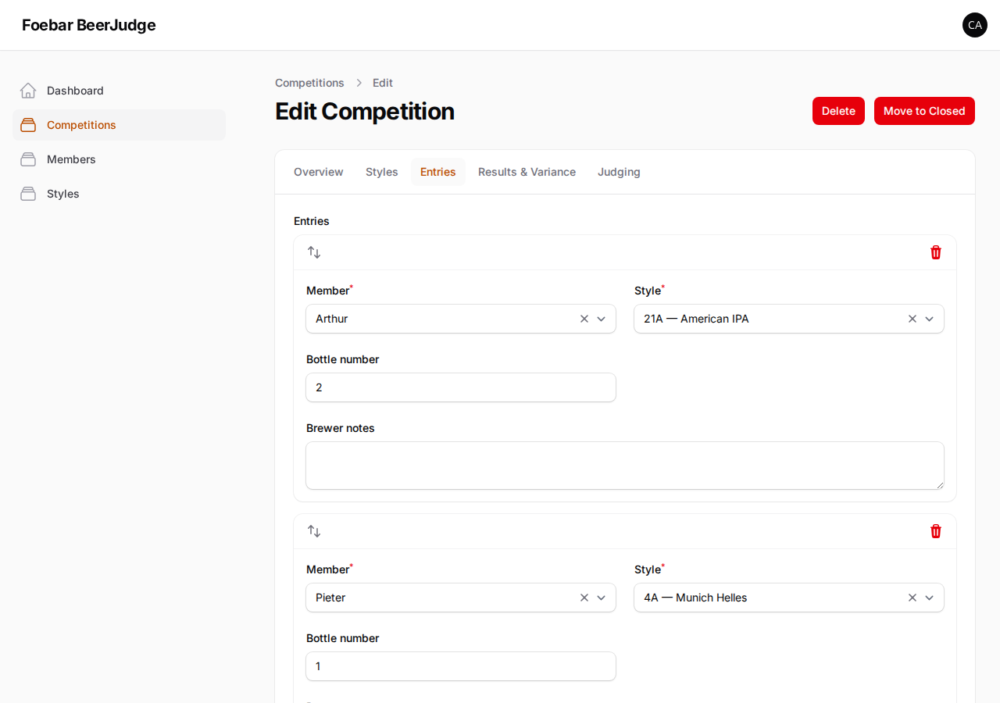

# BeerJudge

Competition management for a small homebrew club. Members register beers, judges score them on the BJCP 50-point scale, and each competition produces a ranked result list.

Deliberately narrow in scope: no payments, no shipping, no BJCP report generation, no multi-club support. Built for roughly ten people running four competitions a year.

## Screenshots

| Home | Judging screen | Scoresheet |
|---|---|---|
|  |  |  |

| Admin — competition entries | Results |
|---|---|
|  |  |

## Stack

- Laravel 13 + Filament 4 (admin panel)
- Blade + Alpine.js (judging screen)
- IndexedDB for offline scoresheet backup on the judging screen
- Postgres + Redis (production); SQLite + database drivers (simple local)
- Session-based auth; sessions last about a week

No Livewire on the judging screen. Livewire re-renders from the server on every interaction, which drops in-progress input on a network blip. Alpine handles local state; IndexedDB backs it up.

## Getting started

### Simple local setup (SQLite)

```bash
cp .env.example .env
php artisan key:generate
composer install
php artisan migrate --seed     # seeds the full BJCP 2021 style set
npm install && npm run build
php artisan serve
```

### Local dev with Postgres + Redis (production parity)

Requires Docker. Starts only the backing services so Vite HMR and fast PHP iteration still work:

```bash
cp .env.docker.example .env
# edit .env: set APP_KEY (php artisan key:generate) and adjust credentials if needed
composer install
npm install
docker compose up postgres redis   # starts postgres:16 and redis:7, exposed on localhost
php artisan migrate --seed
composer run dev                   # artisan serve + queue:listen + vite
```

### Full Docker stack

Builds and runs the entire app in a container (nginx + php-fpm + queue worker via supervisord):

```bash
cp .env.docker.example .env
# edit .env: set APP_KEY, CLUB_NAME, APP_URL, and any credentials you want to change
docker compose up --build
# app at http://localhost:8080
```

On first run the container runs `php artisan migrate --force` automatically.

### Running tests

```bash
php artisan test
./vendor/bin/phpstan analyse
```

## Architecture

Two frontends, one app.

**Filament** handles all management: members, competitions, styles, entries, bottle-number assignment, results, and judge variance flags.

**Judging screen** is a single Blade route. The entry list is server-rendered on load; no entries API. Alpine writes each scoresheet to IndexedDB as the judge fills it, then POSTs to the server. On failure it queues and retries. The server upserts by `client_uuid`, so retries are idempotent. A submitted sheet can be reopened and resaved until the competition closes.

## Competition lifecycle

`draft` → `open` → `judging` → `closed`

During `open`, members register entries. When moved to `judging`, registration locks, bottle numbers are assigned, and scoring begins. Judges can score any entry except their own. Once `closed`, everything locks.

Final score is the average of submitted totals. Tiebreak is the averaged overall-impression score (BJCP convention). Rankings are competition-wide, not per style.

## Results

Admin sees results as soon as the competition closes. Members see their own scoresheet once the admin publishes (`published_at` set). One URL per participant: their scores and judge notes, then the full standings with brewer names revealed. Admins can render all participants at once for batch printing.

## Self-hosting

The app ships as a Docker image (nginx + php-fpm + queue worker in one container). Postgres and Redis run as separate containers via Docker Compose.

### Prerequisites

- Docker + Docker Compose on the server
- An [nginx-proxy](https://github.com/nginx-proxy/nginx-proxy) setup (or another reverse proxy) handling TLS termination

### Deploy

1. Copy the repo to the server and create `.env` from `.env.docker.example`. Set at minimum:
   - `APP_KEY` — generate with `php artisan key:generate --show`
   - `APP_ENV=production`, `APP_DEBUG=false`
   - `APP_URL=https://yourdomain.com`
   - `CLUB_NAME`, `DB_PASSWORD`, `MAIL_*`

2. Create `compose.prod.yaml` on the server (not in the repo — it contains host-specific config):

   ```yaml
   services:
     app:
       environment:
         VIRTUAL_HOST: yourdomain.com
         LETSENCRYPT_HOST: yourdomain.com
         VIRTUAL_PORT: 80
   networks:
     default:
       external: true
       name: webproxy   # name of your nginx-proxy network
   ```

3. Start:

   ```bash
   docker compose -f compose.yaml -f compose.prod.yaml up -d --build
   ```

The container runs `php artisan migrate --force` on every start, so deploys are zero-touch. Data persists in named Docker volumes (`postgres_data`, `redis_data`).