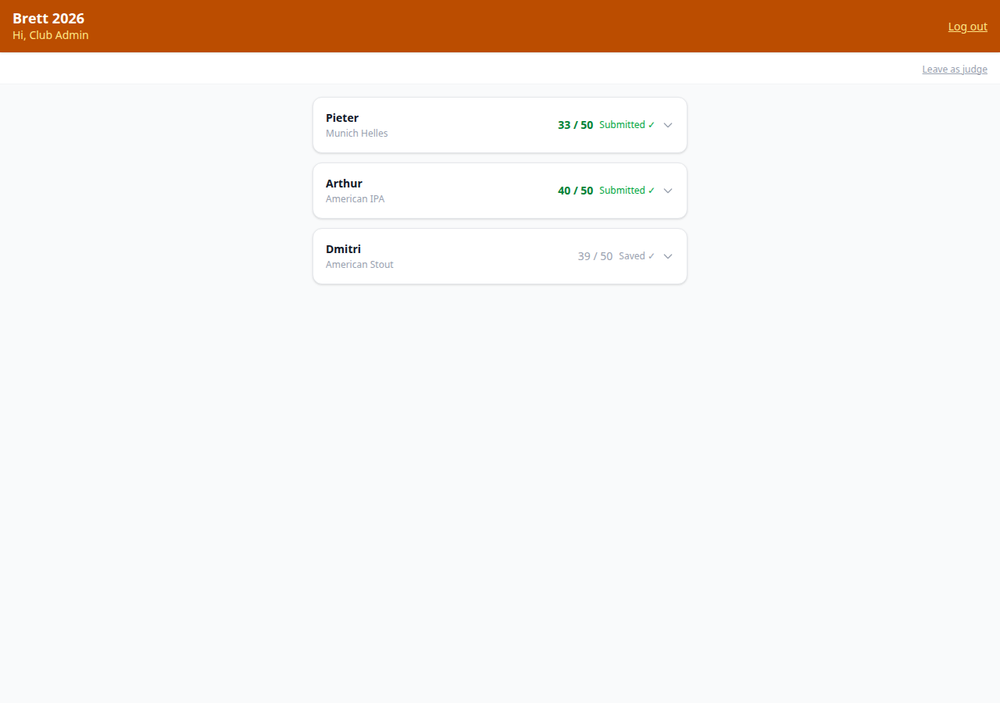
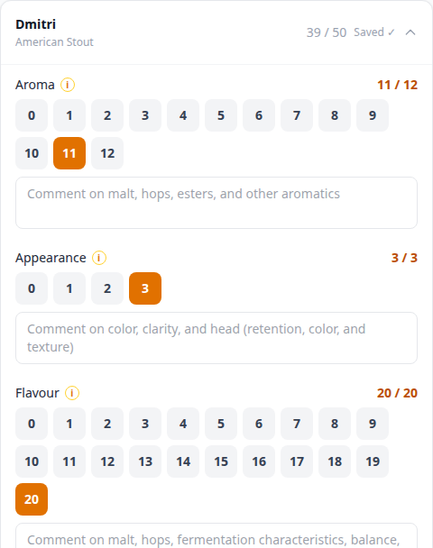
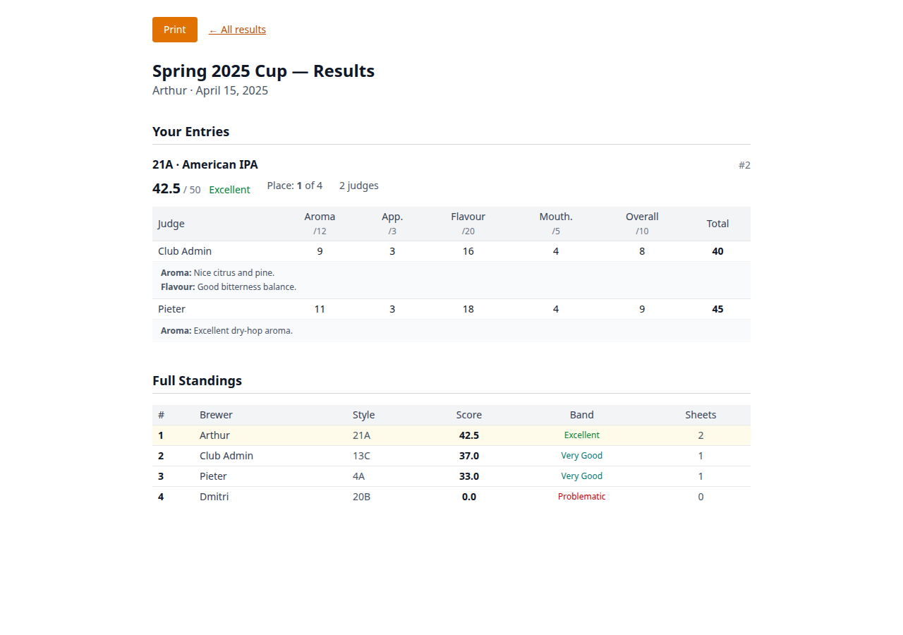

# BeerJudge

Competition management for a small homebrew club. Members register beers, judges score them on the BJCP 50-point scale, and each competition produces a ranked result list.

## Who it is for

- A club running its own in-house competitions: a handful to a few dozen members, a few competitions a year.
- Judging at one table on phones or tablets. The scoresheet keeps working offline and syncs when the connection returns.
- One instance per club. Run a second container for a second club.

## What it does not do

- No payments, shipping or entry fees.
- No per-style flights, medals or best-of-show rounds. Rankings are competition-wide.
- No BJCP report generation or sanctioned-competition paperwork.

Larger or sanctioned competitions are better served by a dedicated competition manager such as [BCOE&M](https://github.com/geoffhumphrey/brewcompetitiononlineentry).

## Screenshots

| Home | Judging screen | Scoresheet |
|---|---|---|
|  |  |  |

| Admin — competition entries | Results |
|---|---|
|  |  |

## Stack

- Laravel 13 + Filament 4 (admin panel)
- Blade + Alpine.js (judging screen)
- IndexedDB for offline scoresheet backup on the judging screen
- Postgres + Redis (production); SQLite + database drivers (simple local)
- Session-based auth; sessions last about a week

No Livewire on the judging screen. Livewire re-renders from the server on every interaction, which drops in-progress input on a network blip. Alpine handles local state; IndexedDB backs it up.

## Getting started

### Quick start (SQLite, no external services)

Needs PHP 8.5 (CI runs 8.5; `composer.json` allows 8.3+), Composer and Node 24. `composer install` checks for the `bcmath`, `intl`, `pdo_pgsql` and `redis` extensions even in SQLite mode, and SQLite needs `pdo_sqlite`.

```bash
git clone https://github.com/oekeur/beerjudge.git && cd beerjudge
composer install
cp .env.example .env
php artisan key:generate
php artisan migrate --seed          # creates database/database.sqlite; loads the BJCP 2021 and Brewers Association 2026 styles
php artisan member:create --admin   # asks for name, email and password
npm install
composer run dev:lite               # artisan serve + queue:listen + pail + vite
```

Open http://localhost:8000 (or the port `artisan serve` prints, if 8000 is taken) and log in with the admin you created. For sample data (eight members, three competitions, scored entries), run `php artisan db:seed --class=DemoSeeder` after `migrate --seed`; the demo members are `member1@beerjudge.local` to `member8@beerjudge.local` with password `password`.

`dev:lite` overrides the database, session, cache and queue drivers at runtime, so the same `.env` also works for the Postgres setup below.

An existing database that predates the Brewers Association styles gets them with `php artisan db:seed --class=BaStyleSeeder --force` (safe to repeat; it upserts by code and source).

### Local dev with Postgres + Redis (production parity)

Starts only the backing services so Vite HMR and fast PHP iteration still work natively. Use this when testing queue behaviour, session handling, or anything that needs to match production closely.

```bash
cp .env.docker.example .env
composer install
php artisan key:generate
npm install
docker compose up postgres redis   # starts postgres:16 and redis:7, exposed on localhost
php artisan migrate --seed
composer run dev                   # artisan serve + queue:listen + pail + vite
```

### Full Docker stack (development)

Builds and runs the entire app in a container, with the source bind-mounted and Vite in its own container:

```bash
cp .env.docker.example .env        # then set APP_KEY and CLUB_NAME
docker compose up --build          # app at http://localhost:8000
```

On every start the container runs `php artisan migrate --force`.

### Running tests

```bash
php artisan test
./vendor/bin/phpstan analyse
```

CONTRIBUTING.md covers the Postgres test run, Playwright browser tests and the commit conventions.

## Architecture

Two frontends, one app.

**Filament** handles all management: members, competitions, styles, entries, bottle-number assignment, results, and judge variance flags.

**Judging screen** is a single Blade route. The entry list is server-rendered on load; no entries API. Alpine writes each scoresheet to IndexedDB as the judge fills it, then POSTs to the server. On failure it queues and retries. The server upserts by `client_uuid`, so retries are idempotent. A submitted sheet can be reopened and resaved until the competition closes.

## Competition lifecycle

`draft` → `open` → `judging` → `closed`

During `open`, members register entries. When moved to `judging`, registration locks, bottle numbers are assigned, and scoring begins. Judges can score any entry except their own. Once `closed`, everything locks.

Final score is the average of submitted totals. Tiebreak is the averaged overall-impression score (BJCP convention). Rankings are competition-wide, not per style.

## Results

Admins see results at any status; members see them once the competition is `closed`. There is no separate publish step. Closing queues an email to every active member with an entry, linking to their sheet. One URL per participant: their scores and judge notes, then the full standings with brewer names revealed. Each sheet is printed from its own page, reached through the results index.

## Documentation

**Judging**
- [Reference](docs/judging/reference.md) — routes, payload shape, validation rules, sync states
- [How to judge a competition](docs/judging/howto-judge.md)
- [Why the judging screen is offline-first](docs/judging/explanation-offline-sync.md)
- [DescriptorService reference](docs/judging/descriptor-service-reference.md) — off-flavour descriptor list and validation
- [Why descriptors are stored as JSON](docs/judging/descriptor-service-explanation.md)

**Competition**
- [Lifecycle reference](docs/competition/lifecycle-reference.md) — status transitions, schema, Filament actions
- [How to run a competition](docs/competition/lifecycle-howto.md)
- [Why the lifecycle has four states](docs/competition/lifecycle-explanation.md)
- [Results reference](docs/competition/results-reference.md) — routes, access rules, view data
- [How to view results](docs/competition/results-howto.md)
- [Ranking service reference](docs/competition/ranking-service-reference.md)
- [Bottle assignment reference](docs/competition/bottle-assignment-reference.md)

**Members**
- [Registration reference](docs/member/registration-reference.md) — invitation model, routes, validation
- [How to register a new member](docs/member/registration-howto.md)
- [Auth reference](docs/member/auth-reference.md) — password, magic link, password reset routes
- [How to log in](docs/member/auth-howto.md)

**Admin**
- [Artisan commands reference](docs/admin/artisan-commands-reference.md) — member:create, member:delete, member:password
- [How to create a member via CLI](docs/admin/artisan-commands-howto.md)
- [BJCP seeder reference](docs/admin/bjcp-seeder-reference.md)
- [How to seed BJCP styles](docs/admin/bjcp-seeder-howto.md)
- [Why Filament](docs/admin/filament-overview-explanation.md)

**Architecture**
- [Two-frontend architecture](docs/architecture/two-frontend-explanation.md) — Filament vs Blade+Alpine split
- [BJCP scoring model](docs/architecture/bjcp-scoring-explanation.md) — sections, bands, ranking, tiebreak

**Operations**
- [Environment variables](docs/env-reference.md)
- [Docker reference](docs/docker-reference.md)
- [How to deploy with Docker](docs/docker-howto.md)
- [PWA reference](docs/pwa-reference.md)

## Self-hosting

The app ships as a Docker image, `ghcr.io/oekeur/beerjudge`, with nginx, php-fpm and a queue worker in one container; Postgres and Redis run beside it. [How to self-host with Docker](docs/docker-howto.md) goes from an empty server to a first admin login with one Compose file and one `.env`.

## Contributing

See [CONTRIBUTING.md](CONTRIBUTING.md). To report a security issue, see [SECURITY.md](SECURITY.md).

## License

BeerJudge is released under the [MIT License](LICENSE).

The bundled style data has its own terms: the BJCP 2021 styles come from [beerjson/bjcp-json](https://github.com/beerjson/bjcp-json) (MIT, modified), and the Brewers Association 2026 styles are used with the BA's permission and attribution. Details in [THIRD_PARTY_NOTICES.md](THIRD_PARTY_NOTICES.md).

## Credits

Built by Oscar Keur for the Foebar Amsterdam Homebrew Group, with contributions from [rob518183](https://github.com/rob518183).
